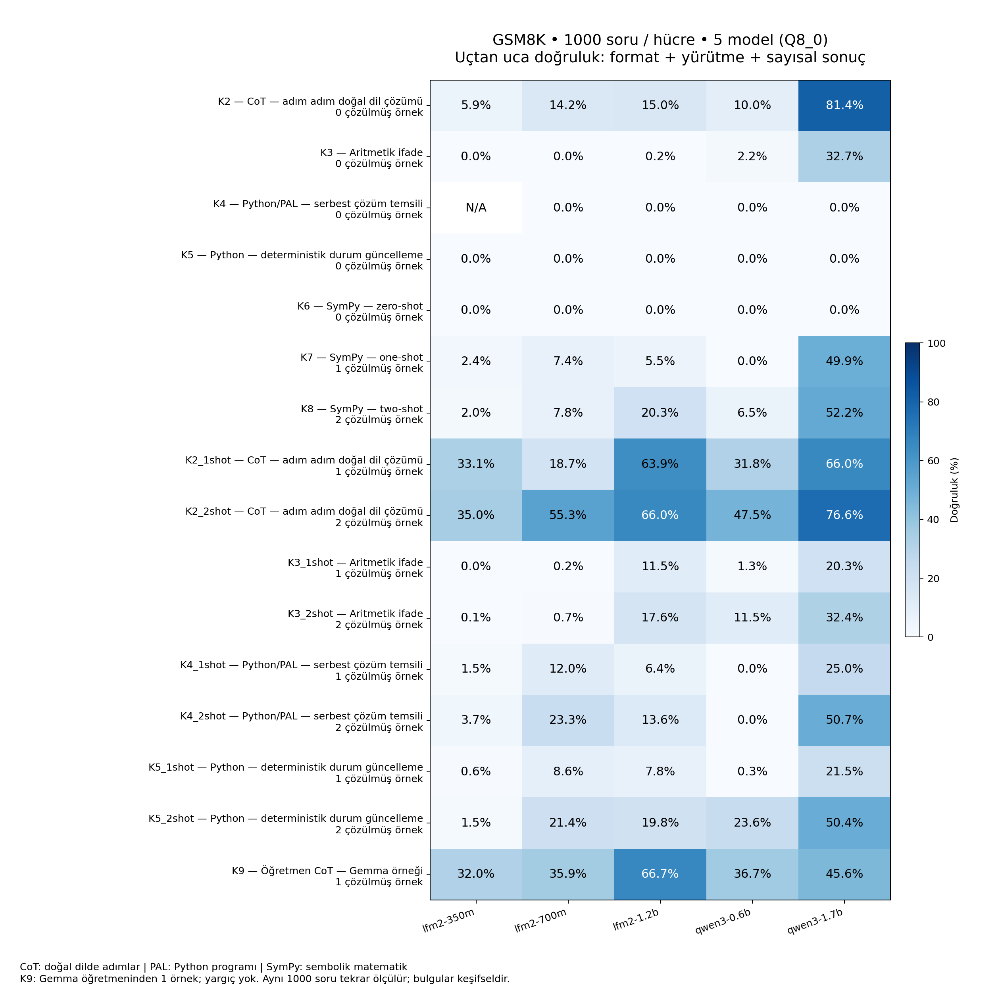

# Küçük modellerde GSM8K

[Türkçe](README.md) · [English](README.en.md)

Yerel Ollama üzerinden temsil biçimi, model büyüklüğü ve çözüm/API örneklerinin
etkisini inceleyen Python projesi. Amaç kontrollü deney ve hata analizidir;
yeni yöntem veya literatürde öncelik iddiası yoktur.

## Güncel kapsam

Beş model: LFM2-350M, LFM2-700M, LFM2-1.2B, Qwen3-0.6B, Qwen3-1.7B.
Hepsi resmî yayıncı GGUF ağırlıklarından Q8_0 ile hazırlanmış yerel Ollama alias'larıdır.
Kaynaklar ve dosya sürümleri [model manifestinde](configs/models.json), doğrulanmış
Ollama digestleri [kilit dosyasında](configs/model-lock.json) sabittir.

| Koşul | Görev | Örnek sayısı |
|---|---|---:|
| K2 | Doğal dilde adım adım çözüm (CoT) | 0 |
| K2_1shot / K2_2shot | CoT | 1 / 2 |
| K3 | Güvenli hesaplayıcı için aritmetik ifade | 0 |
| K3_1shot / K3_2shot | Aritmetik ifade | 1 / 2 |
| K4 | Serbest Python/PAL | 0 |
| K4_1shot / K4_2shot | Python/PAL | 1 / 2 |
| K5 | Deterministik durum güncelleyen Python | 0 |
| K5_1shot / K5_2shot | Durum güncelleme | 1 / 2 |
| K6 / K7 / K8 | SymPy | 0 / 1 / 2 |
| K9 | Gemma öğretmeninden sabit CoT açıklaması | 1 |

Toplam **16 koşul/model**. K1, K10 ve Gemma yargıç değerlendirmesi bulunmaz.
Gemma yalnız K9'un önceden üretilmiş öğretmen örneğinin kaynağıdır.
A çiftinde train 0/2 kullanılır; K9 yalnız train 0 açıklamasını kullanır.

## Deney sonuçları — 1000 soru

**Koşum tamamlandı:** 1000 farklı soru × 16 koşul × 5 model = **80.000 kayıt**. Bunların **79.999’u değerlendirilebilir**; bir Ollama isteği altyapı hatası verdi ve yeniden üretilmedi. Koşum kimliği: `db66d8df297c69c75c54`.

Örneklem, resmî GSM8K main train+test birleşiminden aktif demonstration soruları çıkarıldıktan sonra seed `20261021` ile seçildi: **858 train + 142 test**. Soru kimlikleri/hashleri [sabit manifestte](data/sample1000-manifest.json). Önceki 200 soruluk pilotla örtüşen 18 soru manifestte işaretlidir. Bu, bağımsız held-out test veya resmî test benchmark skoru değildir; daha önceki keşifsel çalışmalardan sonra sabitlenmiş tasarımla yapılan bir örneklem değerlendirmesidir.

### Açıklamalı grafik



**Grafik nasıl okunur?** Satırlar koşulları, sütunlar modelleri gösterir; koyu mavi daha yüksek doğruluktur. Her hücre 1000 soruya dayanır. Yüzde, doğru sayısının planlanan 1000 soruya bölünmesidir; yalnız eksiksiz değerlendirilen hücrelerde gösterilir. `N/A`, bir altyapı eksiği nedeniyle tamamlanmış doğruluk verilemeyen hücredir. `1shot` bir, `2shot` iki çözülmüş örnek anlamına gelir; tekrar üretim sayısı değildir. CoT doğal dilde adım adım çözüm, PAL Python programı, SymPy sembolik matematik kodudur. Koşul açıklamaları yukarıdaki tabloda ve grafikte bulunur.

**Ölçüt uçtan uca başarıdır:** format, yürütme ve sayısal cevap birlikte değerlendirilir. Bu yüzden grafik saf matematiksel yetenek ölçümü olarak yorumlanmamalıdır.

### Bütün koşullarda doğruluk (%)

| Koşul | LFM2-350M | LFM2-700M | LFM2-1.2B | Qwen3-0.6B | Qwen3-1.7B |
|---|---:|---:|---:|---:|---:|
| K2 | 5.9 | 14.2 | 15.0 | 10.0 | 81.4 |
| K3 | 0.0 | 0.0 | 0.2 | 2.2 | 32.7 |
| K4 | N/A¹ | 0.0 | 0.0 | 0.0 | 0.0 |
| K5 | 0.0 | 0.0 | 0.0 | 0.0 | 0.0 |
| K6 | 0.0 | 0.0 | 0.0 | 0.0 | 0.0 |
| K7 | 2.4 | 7.4 | 5.5 | 0.0 | 49.9 |
| K8 | 2.0 | 7.8 | 20.3 | 6.5 | 52.2 |
| K2_1shot | 33.1 | 18.7 | 63.9 | 31.8 | 66.0 |
| K2_2shot | 35.0 | 55.3 | 66.0 | 47.5 | 76.6 |
| K3_1shot | 0.0 | 0.2 | 11.5 | 1.3 | 20.3 |
| K3_2shot | 0.1 | 0.7 | 17.6 | 11.5 | 32.4 |
| K4_1shot | 1.5 | 12.0 | 6.4 | 0.0 | 25.0 |
| K4_2shot | 3.7 | 23.3 | 13.6 | 0.0 | 50.7 |
| K5_1shot | 0.6 | 8.6 | 7.8 | 0.3 | 21.5 |
| K5_2shot | 1.5 | 21.4 | 19.8 | 23.6 | 50.4 |
| K9 | 32.0 | 35.9 | 66.7 | 36.7 | 45.6 |

¹ LFM2-350M / K4: **0 doğru, 999 değerlendirilebilir çıktı, 1 altyapı hatası**. Planlanan paydada doğruluk alt sınırı %0; eksik hücre tamamlanmış skor olarak sunulmaz. Diğer hücrelerin her biri 1000/1000 değerlendirilebilirdir. Ondalıklar bir basamakla gösterilir; bir doğru yanıt 0,1 yüzde puandır.

### Bulgular ve yorum

- **Örneklerin etkisi modele bağlı.** İki CoT örneğiyle LFM2-350M %5,9’dan %35,0’a; LFM2-700M %14,2’den %55,3’e; LFM2-1.2B %15,0’dan %66,0’a; Qwen3-0.6B %10,0’dan %47,5’e çıktı. Buna karşılık Qwen3-1.7B’de örneksiz CoT %81,4 ile iki örnekli CoT’nin (%76,6) üzerindeydi. Dolayısıyla daha çok örnek her modelde daha iyi sonuç vermiyor. Bu farkların tümü için ayrı doğrulayıcı test yapıldığı iddia edilmez.
- **Harici hesaplama kolları bu koşumda en iyi doğal dil kolunu geçemedi.** Bunun önemli bir bileşeni istenen temsile/çıktı sözleşmesine uyumdur. Örneksiz Python ve SymPy kollarında program yerine `FINAL: 540` gibi cevaplar görüldü. Bu metin Python’da değişken anotasyonu olarak ayrıştırılabilir, fakat hiçbir çıktı yazdırmaz; sayısal bir cevap içermesi yürütme başarısı sayılmaz. Bu yüzden bu kollardaki sıfırlar tek başına matematiksel yetersizlik kanıtı değildir.
- **Durum güncellemenin serbest PAL’e genel üstünlüğü gözlenmedi.** İki örnekte K5, LFM2-1.2B’de %19,8 ile K4’ün %13,6’sından; Qwen3-0.6B’de %23,6 ile K4’ün %0’ından yüksek. LFM2-350M/700M’de daha düşük; Qwen3-1.7B’de yakın (%50,4 / %50,7). Süreç sorularına özgü avantaj veya gerçek strateji uyumu için insan anotasyonları henüz tamamlanmadı.
- **SymPy örnekleri özellikle Qwen3-1.7B’de yürütülebilir başarıyı artırdı:** örneksiz K6 %0, bir örnekli K7 %49,9, iki örnekli K8 %52,2. Ancak yine de aynı modelin örneksiz CoT skorunun altında. Gözlenen kazanç API öğretimi, çıktı biçimi ve genel örnek faydasını birlikte içerir.
- **Gemma öğretmen örneği tek tip etki göstermedi.** K9 ile standart tek örnekli CoT aynı örnek sorusunu ve örnek sayısını kullanır; açıklama içeriği/kaynağı değişir. LFM2-700M ve Qwen3-0.6B’de artış, Qwen3-1.7B’de düşüş gözlendi. LFM2-1.2B’nin en yüksek gözlenen skoru K9’da %66,7 olsa da bu, standart tek örnekli CoT’ye üstünlük için yeterli istatistiksel kanıt değildir.

### K9 − standart tek örnekli CoT: eşleştirilmiş karşılaştırma

Aşağıdaki farklar **yüzde puan**dır. Her modelde aynı 1000 soru eşleştirilmiştir. %95 aralıklar 10.000 soru bazlı bootstrap örneklemesinden; p değerleri iki taraflı exact McNemar testi ve beş model için Holm düzeltmesindendir. Karşılaştırmalar keşifseldir.

| Model | K9 − K2_1shot | %95 bootstrap aralığı | Holm p |
|---|---:|---:|---:|
| lfm2-350m | -1.1 | [-4.3, +2.0] | 0.539 |
| lfm2-700m | +17.2 | [+13.9, +20.5] | 1.42e-22 |
| lfm2-1.2b | +2.8 | [-0.2, +5.8] | 0.167 |
| qwen3-0.6b | +4.9 | [+2.3, +7.5] | 0.001 |
| qwen3-1.7b | -20.4 | [-23.4, -17.4] | 3.57e-36 |

### Hata dağılımı ve süre

Aşağıdaki sayılar 80.000 koşul/model çıktısının dağılımıdır; 80.000 bağımsız matematik sorusu değildir. Hata etiketleri yürütme/parser sonuçlarıdır; insan tarafından doğrulanmış semantik nedenler değildir.

| Sonuç | Sayı |
|---|---:|
| Doğru | 14,137 |
| Ayrıştırılmış, yanlış cevap | 15,442 |
| Format/ayrıştırma hatası | 28,158 |
| Sözdizimi hatası | 19,738 |
| Çalışma zamanı/API hatası | 1,431 |
| Zaman/kaynak sınırı | 398 |
| Üretim kesilmesi | 695 |
| Altyapı hatası | 1 |

Apple M3 Max / 36 GiB ortamında üretim **10.99 saat**, izole yürütme/yorumlama **1.54 saat**; toplam ölçülen süre **12.53 saat**. Model yükleme **14.2 dakika** ve üretim süresinin içindedir; toplam süreye ikinci kez eklenmez. Donanım/iş yükü değiştiğinde aynı hız garanti edilmez.

Giriş/çıkış tokenları: **22,472,679 / 7,629,427**. Prompt cache kullanımına izin verildi; **6,607,335 cached token**, eksik sayaç yok. İsteklerin **79.995’inde** model önceden bellekteydi; beş istek soğuk başladı.

### Yorumlama sınırları ve indirilebilir dosyalar

Koşullar aynı soruların tekrarlı ölçümleridir; bağımsız gözlem gibi birleştirilmez. Modeller arasında mimari, eğitim ve parametre sayısı birlikte değişir. Az sayıdaki boyuttan evrensel yetenek eşiği çıkarılamaz. Soru türü etiketleri ve insan hata incelemesi tamamlanmadan süreç/denklem alt grupları veya semantik hata nedenleri hakkında sonuç iddiası üretilmez. K9 tek sabit öğretmen örneğine dayanır; diğer örnek çiftleriyle sağlamlık henüz ölçülmedi. Model eğitim verisiyle GSM8K örtüşmesi dışlanamaz.

- [Kendi başına okunabilen ayrıntılı rapor](reports/db66d8df297c69c75c54/REPORT.md)
- [Grafik — PNG](reports/db66d8df297c69c75c54/accuracy.png) · [SVG](reports/db66d8df297c69c75c54/accuracy.svg)
- [Makine tarafından okunabilir sonuçlar](reports/db66d8df297c69c75c54/summary.json) · [Hücre tablosu ve maliyetler](reports/db66d8df297c69c75c54/summary.csv)
- [Koşum denetimi](reports/db66d8df297c69c75c54/audit.json)
- [Rapor, grafik, sonuçlar ve soru manifesti — ZIP](reports/db66d8df297c69c75c54/GSM8K_REPORT_PACKAGE.zip)

## Kurulum ve kontrol

```bash
python3 -m venv .venv
.venv/bin/pip install -r requirements.lock
.venv/bin/python -m gsm8k_lab check
.venv/bin/python scripts/k9.py verify
.venv/bin/python -m pytest -q
# Gerçek Docker izolasyon testleri:
GSM8K_DOCKER_TESTS=1 .venv/bin/python -m pytest -q tests/test_sandbox.py
```

Ollama loopback üzerinde çalışmalıdır; dış ağa açmayın. Python/SymPy için Docker
Desktop ve `gsm8k-sandbox:py3.12.8-sympy1.13.3` imajı gerekir. İmaj yoksa:
`docker build -t gsm8k-sandbox:py3.12.8-sympy1.13.3 sandbox`.
Model hazırlama: `.venv/bin/python -m gsm8k_lab prepare-models`.
Veri yeniden indirilecekse önce `requirements-data.txt` bağımlılıklarını yükleyip
`.venv/bin/python scripts/prepare_hf_data.py`, ardından
`.venv/bin/python -m gsm8k_lab prepare-data` çalıştırın. Mevcut veri hazırlanmıştır.

## 10 soruluk hızlı doğrulama

Bu komutlar 16 koşulun sabit 10 soruluk doğrulamasını çalıştırır. Yukarıdaki sonuçlar ayrı 1000 soruluk koşuma aittir.

```bash
# 5 model × 16 koşul × 10 sabit pilot sorusu = 800 üretim
.venv/bin/python scripts/repeat10.py run
.venv/bin/python scripts/repeat10.py resume RUN_ID
.venv/bin/python scripts/repeat10.py analyze RUN_ID
# Açıklamalı rapor/grafik: model çağrısı yapmadan sunumu günceller
.venv/bin/python scripts/explain_report.py RUN_ID
```

[repeat10.json](configs/repeat10.json), `results/repeat10-warm.sqlite` dosyasına
yazar. Run ID kaynak/config/prompt/model kimliklerinden türetilir. Aynı koşum
tekrar çağrıldığında kayıtlar atlanır veya devam ettirilir. Kaynak değişirse yeni
kimlik gerekir. [Tekrar protokolü](docs/REPEAT10_PROTOCOL.md).

## 1000 soruluk birleşik örneklem

Train+test havuzundan aktif demonstration soruları çıkarılarak seed20261021 ile
1000 soru seçilir: 858 train, 142 test; manifest data/sample1000-manifest.json.
1000 × 16 koşul × 5 model = 80.000 üretim; keep_alive30m, cache izinli.
Önceki pilotla örtüşen 18 soru işaretlidir; yeni örneklem bağımsız held-out test değildir.
Sonuçlar results/sample1000-warm.sqlite dosyasına yazılır. [Protokol](docs/SAMPLE1000_PROTOCOL.md).

```bash
.venv/bin/python scripts/sample_run.py run
.venv/bin/python scripts/sample_run.py status
.venv/bin/python scripts/sample_run.py resume RUN_ID
.venv/bin/python scripts/sample_run.py analyze RUN_ID
```

Koşum tamamlandı; açıklamalı rapor, grafik ve ZIP yukarıda sunulmuştur. Yeni koşum veya yeniden analiz sonrası bu dosyalar otomatik oluşturulur.
Uzun koşum başlatıcısı caffeinate ile boşta uyumayı koşum süresince engeller;
ilerleme artifacts/sample1000.log ve artifacts/repeat1000-latest.json içindedir.

## Pilot ve ana test kapsamı

Temel CLI **K9 hariç 15 koşul** destekler. `scripts/repeat10.py` ise K9 dahil
16 koşulu yalnız 10 soruda çalıştırır. K9'u 200 soru veya tam teste genişleten
birleşik runner henüz yoktur; bu kapsamın hazır olduğu iddia edilmez.

```bash
.venv/bin/python -m gsm8k_lab smoke --models lfm2-350m
.venv/bin/python -m gsm8k_lab pilot
.venv/bin/python -m gsm8k_lab resume RUN_ID
.venv/bin/python -m gsm8k_lab analyze RUN_ID
.venv/bin/python -m gsm8k_lab review RUN_ID
.venv/bin/python -m gsm8k_lab estimate --pilot-run RUN_ID
.venv/bin/python -m gsm8k_lab freeze RUN_ID
# Yalnız yeni pilot/protokol sabitlendikten ve kullanıcı istediğinde:
.venv/bin/python -m gsm8k_lab main
```

Temel pilot 15.000, temel tam test 98.925 üretimdir. Temel CLI
`results/base-warm.sqlite` kullanır. Geçersiz eski protokol dondurması kaldırıldı;
yeni tam test için `freeze` zorunludur. B/C sağlamlık koşulları temel CLI'de
`robustness --pair B` / `--pair C` ile ayrıdır; aynı soru bağımsız örnek sayılmaz.

## Veri ve değerlendirme

Resmî [openai/gsm8k main](https://huggingface.co/datasets/openai/gsm8k): revision
`740312add88f781978c0658806c59bc2815b9866`. Train 7.473, test 1.319.
Seed 20261021 ile train'den ayrılmış 200 pilot sorusu; demonstrationlar pilot dışında.
İngilizce metinler korunur. Gold yalnız değerlendirme katmanındadır.

Temperature=0, context=4096, output=512, Qwen think=false; tüm ayarlar kaydedilir.
[Cache politikası](docs/CACHE_POLICY.md): `keep_alive="30m"`; model istekler arasında
bellekte tutulur, prompt cache kullanımına izin verilir ve sayaçlar kaydedilir.
Python/SymPy yalnız ağsız, host dosyası bağlanmayan, kaynakları sınırlı Docker'da
çalışır. İzolasyon yoksa host yürütme yapılmaz. Aritmetik AST izin listelidir.
CoT son satırda `FINAL: <sayı>`; kod stdout'u yalnız tek `FINAL: <sayı>` satırı;
aritmetik ifade kolunda bütün yanıt tek ifadedir. Format hataları doğruluğa dahildir.
Ölçülen değer uçtan uca başarıdır; salt matematik becerisi olarak yorumlanmaz.

[Deney protokolü](docs/PROTOCOL.md), [anotasyon yönergesi](docs/ANNOTATION.md),
[K9 örnekleri](docs/K9_PROTOCOL.md), [model kaynakları](docs/MODELS_AND_SOURCES.md).

## Sonuç dosyalarının paylaşılması

GitHub README grafiği göreli dosya yoluyla gösterir. `reports/db66d8df297c69c75c54/`
klasöründeki rapor, PNG/SVG, summary.json/CSV, audit.json ve ZIP dosyalarını da
repoya ekleyin. Gerçek ham yanıtlar yerel `results/sample1000-warm.sqlite` içinde
saklanır; büyük SQLite dosyaları ve model ağırlıkları `.gitignore` ile dışarıda
bırakılır. Paylaşım paketi tüm ham model yanıtlarını içermez; özet sonuçları,
yöntemi ve soru manifestini içerir. Tam ham kayıtların yeniden incelenmesi için
SQLite veritabanı ayrıca veri deposu/release üzerinden paylaşılmalıdır.
